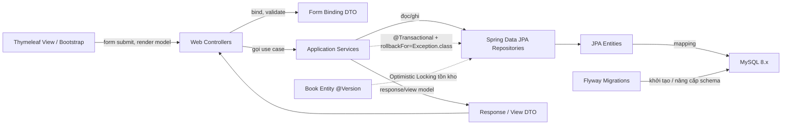

# Danh mục package, class
# BẢN ĐỒ DỰ ÁN VÀ QUY TẮC TIẾT KIỆM TOKEN

## 1. Sơ đồ phụ thuộc (CodeGraph)

### Luồng phụ thuộc đã triển khai / kiến trúc mục tiêu



Sơ đồ mô tả các phụ thuộc đã triển khai cho module Borrowing cùng các lớp mục tiêu còn lại; đây không phải kết quả phân tích từ chỉ mục CodeGraph. Thư mục `.codegraph` hiện không có trong repo.

### Trạng thái mã nguồn đã kiểm tra

- Application entry point hiện có tại `org.example.library.LibraryApplication`.
- `LibraryApplication` là Spring Boot entry point; `ServletInitializer` cấu hình triển khai WAR.
- Borrowing module đặt tại package `com.library`; entry point cấu hình component scan, JPA entity scan và repository scan cho package này.
- `pom.xml` dùng Java 17 / Spring Boot 3.5.6 và có Thymeleaf, Spring Web, Spring Data JPA, Validation, Flyway, MySQL Connector/J và Lombok.
- Các lớp Entity, Repository, DTO, Mapper, Service và Controller của Borrowing đã được hiện thực hóa; migration Flyway nằm trong `src/main/resources/db/migration/`.
- Datasource lấy cấu hình từ `DB_URL`, `DB_USERNAME`, `DB_PASSWORD`; test profile dùng H2 và tắt Flyway.

## 2. Package layout hiện tại

```text
org.example.library
├── LibraryApplication
└── ServletInitializer

com.library
├── config
├── controller
├── dto
├── entity
├── mapper
├── repository
└── service
```

Thymeleaf templates cho Borrowing nằm tại `src/main/resources/templates/borrowings/`. Controller nhận Form DTO, xác thực và gọi Service; Entity JPA không bind trực tiếp vào Thymeleaf. Service điều phối transaction; Repository cô lập truy cập dữ liệu. Các module sách/thành viên/danh mục còn lại chưa được hiện thực hóa trong package `com.library`.