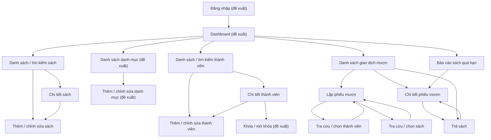

# Đặc tả BA — Sitemap và Mượn/Trả sách

> **Cơ sở:** `.ai/00_project_brief.md` và contract trong `prompts/ba_agent.md`. Các module summaries hiện có trong `.ai/03_module_summaries/` đang rỗng. Vì vậy, các nội dung chưa được brief xác nhận được ghi rõ là **đề xuất** hoặc **Open Question**, không coi là chính sách nghiệp vụ đã chốt.

## 1. Phạm vi và giả định

### Yêu cầu đã được xác nhận

- Hệ thống web quản lý thư viện nội bộ, bao gồm sách, thành viên, mượn/trả và báo cáo quá hạn.
- Tồn kho khả dụng (`availableQuantity`) phải chính xác.
- Phạt **5.000 VNĐ/ngày cho mỗi cuốn sách** nếu trả quá hạn.
- Email thành viên không được trùng; thành viên bị khóa không được mượn.
- Các thao tác mượn/trả phải nhất quán dữ liệu và chạy trong transaction.

### Giả định giao diện để lập sitemap

- **Thủ thư/Nhân viên thư viện** là người dùng chính thao tác các giao dịch trên ứng dụng nội bộ.
- Các màn hình đăng nhập, dashboard, danh mục và quản lý giao dịch được đề xuất để tạo một luồng sử dụng đầy đủ; brief chưa xác nhận chi tiết các chức năng này.
- Không giả định thời hạn mượn, số lượng sách tối đa, cơ chế thu phạt, phân quyền, hay cách định danh thành viên/sách. Các điểm này cần được xác nhận trước khi chốt thiết kế.

## 2. Sitemap tổng thể

| Khu vực | Màn hình | Mục đích / thao tác chính | Căn cứ |
|---|---|---|---|
| Truy cập | Đăng nhập | Đề xuất: xác thực nhân viên để truy cập hệ thống nội bộ. | Chưa xác nhận trong brief |
| Tổng quan | Dashboard | Đề xuất: điều hướng nhanh tới sách, thành viên, giao dịch và báo cáo; có thể hiển thị chỉ số tổng quan sau khi chốt nhu cầu. | Chưa xác nhận trong brief |
| Sách | Danh sách / tìm kiếm sách | Tra cứu sách; hiển thị thông tin cơ bản và tồn kho khả dụng. | Sách và `availableQuantity` có trong brief |
| Sách | Chi tiết sách | Xem thông tin một đầu sách và tình trạng khả dụng. | Đề xuất chi tiết hóa chức năng sách |
| Sách | Thêm / chỉnh sửa sách | Tạo hoặc cập nhật thông tin sách. | Sách có trong brief; trường dữ liệu chưa xác định |
| Danh mục | Danh sách danh mục | Đề xuất: xem các danh mục sách. | Có module summary nhưng file rỗng; cần xác nhận phạm vi |
| Danh mục | Thêm / chỉnh sửa danh mục | Đề xuất: quản lý danh mục nếu chức năng này thuộc phạm vi. | Chưa xác nhận trong brief |
| Thành viên | Danh sách / tìm kiếm thành viên | Tra cứu thành viên và nhận biết trạng thái bị khóa. | Thành viên và quy tắc khóa có trong brief |
| Thành viên | Chi tiết thành viên | Xem hồ sơ và thông tin giao dịch liên quan nếu được hỗ trợ. | Đề xuất chi tiết hóa chức năng thành viên |
| Thành viên | Thêm / chỉnh sửa thành viên | Tạo/cập nhật hồ sơ; kiểm tra email không trùng. | Quy tắc email có trong brief |
| Thành viên | Khóa / mở khóa thành viên | Đề xuất: cập nhật trạng thái; thành viên đang bị khóa không được mượn. | Trạng thái khóa có trong brief; thao tác quản trị cần xác nhận |
| Mượn/Trả | Danh sách giao dịch mượn | Tra cứu các lượt mượn và trạng thái còn mượn/đã trả/quá hạn. | Mượn/trả có trong brief; trạng thái hiển thị là đề xuất |
| Mượn/Trả | Lập phiếu mượn | Chọn thành viên và một hoặc nhiều sách, xác nhận giao dịch mượn. | Mượn và kiểm tra thành viên bị khóa/tồn kho có trong brief |
| Mượn/Trả | Chi tiết phiếu mượn | Xem thành viên, sách, ngày mượn/hạn trả và tình trạng từng cuốn. | Đề xuất chi tiết hóa chức năng mượn |
| Mượn/Trả | Trả sách | Tra cứu giao dịch, chọn sách trả, ghi nhận trả và khoản phạt quá hạn nếu có. | Trả sách và mức phạt có trong brief |
| Báo cáo | Báo cáo sách quá hạn | Liệt kê các sách/lượt mượn quá hạn để nhân viên theo dõi. | Báo cáo quá hạn có trong brief |

## 3. UI Navigation Flow

**Ghi chú:** Đăng nhập, dashboard và danh mục là các màn hình đề xuất do brief chưa nêu chi tiết. Cần xác nhận có đưa vào phạm vi phát triển hay không. Các màn hình sách, thành viên, mượn/trả và báo cáo quá hạn bám theo các nội dung được brief nêu.

## 4. Use Case UC-BOR-01 — Lập phiếu mượn

### Mục tiêu

Ghi nhận việc một thành viên mượn sách, ngăn mượn khi thành viên bị khóa hoặc sách không còn khả dụng, đồng thời cập nhật tồn kho nhất quán.

### Actor

- **Chính:** Thủ thư/Nhân viên thư viện (vai trò đề xuất; brief chưa quy định tên vai trò).
- **Liên quan:** Thành viên cung cấp thông tin để nhân viên tra cứu; chưa có bằng chứng thành viên tự thao tác trên hệ thống.

### Tiền điều kiện

1. Nhân viên đang ở màn hình lập phiếu mượn.
2. Thành viên cần được tra cứu và xác định trạng thái.
3. Sách được chọn phải có số lượng khả dụng lớn hơn 0 tại thời điểm xác nhận.

### Luồng chính

1. Nhân viên mở **Lập phiếu mượn**.
2. Nhân viên tra cứu và chọn thành viên.
3. Hệ thống hiển thị thông tin nhận diện và trạng thái thành viên.
4. Nhân viên tra cứu sách, chọn sách và số lượng cần mượn.
5. Hệ thống hiển thị số lượng khả dụng; nhân viên nhập hạn trả theo chính sách thư viện đã cấu hình/xác nhận.
6. Nhân viên rà soát thông tin thành viên, các sách và hạn trả, sau đó xác nhận.
7. Hệ thống kiểm tra lại trạng thái thành viên và tồn kho tại thời điểm ghi nhận.
8. Trong một transaction, hệ thống tạo phiếu mượn, lưu các dòng sách được mượn và cập nhật `availableQuantity`.
9. Hệ thống xác nhận thành công và hiển thị chi tiết phiếu mượn.

### Luồng thay thế / ngoại lệ

- **A1 — Không tìm thấy thành viên:** Hệ thống thông báo không có kết quả; nhân viên điều chỉnh tiêu chí tìm kiếm hoặc dừng thao tác.
- **A2 — Thành viên bị khóa:** Hệ thống không cho xác nhận phiếu; thông báo thành viên bị khóa. Không thay đổi phiếu hoặc tồn kho.
- **A3 — Không tìm thấy sách:** Hệ thống thông báo không có sách phù hợp; nhân viên đổi từ khóa hoặc bỏ sách đó khỏi phiếu.
- **A4 — Số lượng không hợp lệ:** Hệ thống từ chối số lượng nhỏ hơn 1 hoặc không phải số nguyên dương; yêu cầu nhập lại.
- **A5 — Không đủ tồn kho:** Hệ thống báo số lượng khả dụng mới nhất; không ghi nhận phần vượt quá. Nhân viên điều chỉnh số lượng hoặc bỏ sách.
- **A6 — Tồn kho/trạng thái thành viên thay đổi trước khi xác nhận:** Hệ thống kiểm tra lại và từ chối giao dịch nếu điều kiện không còn thỏa mãn; yêu cầu nhân viên làm mới dữ liệu.
- **A7 — Lỗi khi lưu:** Toàn bộ thay đổi của giao dịch phải rollback; không được tạo phiếu dở dang hoặc cập nhật tồn kho một phần. Hiển thị lỗi để nhân viên thử lại sau khi kiểm tra.
- **A8 — Không chọn sách:** Không cho xác nhận phiếu mượn rỗng.

### Hậu điều kiện

- **Thành công:** Phiếu mượn và các dòng sách được lưu; số lượng khả dụng được giảm đúng bằng số lượng đã mượn.
- **Thất bại:** Không có thay đổi một phần đối với phiếu mượn hoặc `availableQuantity`.

## 5. Use Case UC-BOR-02 — Ghi nhận trả sách

### Mục tiêu

Ghi nhận sách được trả, phục hồi tồn kho khả dụng và tính khoản phạt quá hạn theo mức 5.000 VNĐ/ngày cho từng cuốn.

### Actor

- **Chính:** Thủ thư/Nhân viên thư viện (vai trò đề xuất).
- **Liên quan:** Thành viên trả sách tại thư viện; thao tác trực tiếp trên ứng dụng chưa được xác nhận.

### Tiền điều kiện

1. Nhân viên đã tra cứu được phiếu mượn có sách chưa được ghi nhận trả.
2. Giao dịch trả có dữ liệu hạn trả để xác định tình trạng quá hạn.

### Luồng chính

1. Nhân viên mở danh sách giao dịch hoặc báo cáo quá hạn và chọn phiếu mượn cần xử lý.
2. Hệ thống hiển thị thành viên, sách còn mượn, số lượng và hạn trả.
3. Nhân viên chọn sách/số lượng thực tế được trả và xác nhận ngày trả theo ngày hệ thống hoặc ngày được phép ghi nhận.
4. Hệ thống xác định số ngày quá hạn cho từng cuốn; nếu quá hạn, tính phạt theo mức 5.000 VNĐ/ngày/cuốn.
5. Hệ thống hiển thị kết quả trả và khoản phạt để nhân viên kiểm tra.
6. Nhân viên xác nhận ghi nhận trả.
7. Trong một transaction, hệ thống lưu lần trả/trạng thái trả, tính phạt và tăng `availableQuantity` đúng bằng số lượng đã trả.
8. Hệ thống hiển thị xác nhận; phiếu được cập nhật để phản ánh các sách đã trả và còn đang mượn (nếu có).

### Luồng thay thế / ngoại lệ

- **B1 — Không tìm thấy phiếu mượn:** Hệ thống báo không có kết quả; nhân viên tìm lại theo mã giao dịch/thành viên/sách nếu các tiêu chí này được hỗ trợ.
- **B2 — Sách đã được trả:** Không cho ghi nhận trả lần thứ hai; thông báo trạng thái hiện tại và giữ nguyên tồn kho.
- **B3 — Phiếu không có sách còn mượn:** Không cho tiếp tục trả; điều hướng về chi tiết phiếu.
- **B4 — Số lượng trả không hợp lệ hoặc lớn hơn số lượng còn mượn:** Từ chối xác nhận và yêu cầu điều chỉnh.
- **B5 — Không quá hạn:** Số ngày quá hạn và tiền phạt bằng 0.
- **B6 — Trả một phần:** Chỉ cập nhật các cuốn/số lượng được trả; phần chưa trả tiếp tục ở trạng thái đang mượn. (Cần xác nhận nếu hệ thống có quản lý số lượng nhiều bản trong cùng một dòng mượn.)
- **B7 — Lỗi khi lưu:** Rollback toàn bộ thao tác; không được đánh dấu đã trả mà chưa tăng tồn kho, hoặc tăng tồn kho mà chưa ghi nhận trả.

### Hậu điều kiện

- **Thành công:** Trạng thái trả, số ngày quá hạn, tiền phạt và tồn kho được cập nhật nhất quán.
- **Thất bại:** Trạng thái phiếu và số lượng khả dụng không thay đổi một phần.

## 6. Yêu cầu giao diện — Lập phiếu mượn

### Bố cục đề xuất

1. **Thông tin thành viên:** ô tìm kiếm/chọn thành viên và phần tóm tắt hồ sơ, trạng thái.
2. **Danh sách sách mượn:** vùng tìm kiếm sách và bảng các sách đã chọn.
3. **Thông tin hạn trả:** ngày mượn và hạn trả theo chính sách được xác nhận.
4. **Tóm tắt và thao tác:** tổng số lượng, nút xác nhận mượn và hủy/quay lại.
5. Hiển thị lỗi ngay cạnh trường hoặc dòng sách liên quan; giữ dữ liệu nhập được nếu lỗi có thể sửa.

### Trường dữ liệu và kiểm tra

| Trường | Kiểu / bắt buộc | Kiểm tra giao diện và nghiệp vụ |
|---|---|---|
| Tìm thành viên | Ô tìm kiếm; bắt buộc chọn một kết quả | Không cho xác nhận nếu chưa chọn thành viên hợp lệ. Cách tìm theo mã, email hay tên cần xác nhận. |
| Trạng thái thành viên | Chỉ đọc sau khi chọn | Nếu bị khóa, cảnh báo rõ ràng và vô hiệu hóa xác nhận mượn. Phía xử lý giao dịch vẫn phải kiểm tra lại trạng thái. |
| Tìm sách | Ô tìm kiếm; dùng để chọn sách | Chỉ thêm sách đã chọn từ kết quả hợp lệ; tiêu chí tìm kiếm cần xác nhận. |
| Sách được mượn | Ít nhất một dòng | Mỗi dòng phải tham chiếu đến một sách hợp lệ; không cho dòng trùng lặp hoặc cần gộp số lượng (quy tắc trình bày cần chốt). |
| Số lượng | Số nguyên dương; bắt buộc cho mỗi dòng | Phải lớn hơn 0 và không vượt quá số lượng khả dụng được kiểm tra lại khi xác nhận. |
| Số lượng khả dụng | Chỉ đọc | Hiển thị cạnh sách; số liệu khi xác nhận phải được kiểm tra lại để tránh tranh chấp tồn kho. |
| Ngày mượn | Đề xuất: do hệ thống xác định, chỉ đọc | Nguồn ngày/giờ và khả năng ghi nhận lùi ngày cần xác nhận. |
| Hạn trả | Bắt buộc; ngày | Phải hợp lệ so với ngày mượn theo chính sách thư viện. Số ngày mượn tối đa chưa được brief quy định. |
| Ghi chú | Không bắt buộc, đề xuất | Chỉ thêm nếu nghiệp vụ cần; chưa có quy tắc trong brief. |

## 7. Yêu cầu giao diện — Trả sách

### Bố cục đề xuất

1. **Tra cứu giao dịch:** tìm phiếu mượn/thành viên/sách (loại khóa tra cứu cần xác nhận).
2. **Chi tiết phiếu:** thành viên, ngày mượn, hạn trả và danh sách sách chưa trả.
3. **Khu vực ghi nhận trả:** chọn sách/số lượng trả và ngày trả.
4. **Kết quả tính phạt:** số ngày trễ và số tiền theo từng cuốn; tổng tiền là tổng các khoản từng cuốn.
5. **Thao tác:** xác nhận trả hoặc hủy; cảnh báo trước khi xác nhận nếu có phạt.

### Trường dữ liệu và kiểm tra

| Trường | Kiểu / bắt buộc | Kiểm tra giao diện và nghiệp vụ |
|---|---|---|
| Tiêu chí tra cứu | Ô tìm kiếm; bắt buộc để tìm | Chỉ cho phép chọn giao dịch hợp lệ có sách chưa trả. Loại mã tra cứu cần xác nhận. |
| Phiếu mượn | Chọn từ kết quả; bắt buộc | Hiển thị đúng thành viên và các sách còn mượn; không cho xử lý phiếu không tồn tại/không còn sách cần trả. |
| Sách trả | Ít nhất một sách còn mượn | Chỉ chọn các sách thuộc phiếu và chưa được ghi nhận trả. |
| Số lượng trả | Số nguyên dương; bắt buộc theo dòng | Không vượt quá số lượng còn mượn; hỗ trợ trả một phần cần được xác nhận. |
| Ngày trả | Đề xuất: mặc định ngày hệ thống; bắt buộc | Phải hợp lệ theo chính sách ghi nhận ngày trả; cho phép sửa/lùi ngày cần xác nhận. |
| Hạn trả | Chỉ đọc từ phiếu | Cần có giá trị để tính phạt; trường hợp thiếu hạn trả phải chặn ghi nhận và báo nhân viên xử lý dữ liệu. |
| Số ngày quá hạn | Chỉ đọc, hệ thống tính | Không âm; bằng 0 khi không quá hạn. Quy ước ngày lịch/ngày làm việc và cách tính ngày trả trùng hạn cần chốt. |
| Tiền phạt từng cuốn | Chỉ đọc, VNĐ | `số ngày quá hạn × 5.000 VNĐ × số cuốn trả quá hạn`; không tự cộng phạt cho cuốn chưa trả. |
| Tổng tiền phạt | Chỉ đọc, VNĐ | Bằng tổng tiền phạt của các cuốn được trả trong giao dịch hiện tại. |

## 8. Quy tắc nghiệp vụ

1. Thành viên bị khóa không được mượn.
2. Email của thành viên không được trùng. Quy tắc này áp dụng khi tạo/cập nhật hồ sơ thành viên; không được thay bằng một giả định về email là khóa tra cứu duy nhất.
3. Không thể mượn số lượng lớn hơn tồn kho khả dụng tại thời điểm xác nhận.
4. Khi ghi nhận mượn thành công, `availableQuantity` phải giảm đúng theo số lượng mượn; khi ghi nhận trả thành công, tồn kho phải tăng đúng theo số lượng trả.
5. Mức phạt đã xác nhận là 5.000 VNĐ/ngày cho mỗi cuốn quá hạn. Cách xác định “một ngày” và mốc tính ngày cần được thống nhất.
6. Tạo phiếu/lưu các dòng mượn/cập nhật tồn kho phải nguyên tử trong transaction. Ghi nhận trả/cập nhật tình trạng trả/tồn kho/phạt cũng phải nhất quán trong transaction.
7. Trước khi ghi nhận, hệ thống cần kiểm tra lại trạng thái thành viên và tồn kho để xử lý thay đổi đồng thời; chi tiết chiến lược khóa hoặc xử lý xung đột là yêu cầu kỹ thuật cần chốt.
8. Brief chưa chỉ định việc thanh toán/miễn/điều chỉnh tiền phạt. Không coi thao tác ghi nhận trả là thao tác thu tiền.

## 9. Open Questions

1. Vai trò người dùng cụ thể là gì? Có đăng nhập, phân quyền, hay chỉ dùng trong mạng nội bộ không?
2. Dashboard và quản lý danh mục có thuộc phạm vi bản phát hành không?
3. Thành viên/sách được tìm kiếm bằng mã, email, ISBN, nhan đề hay các trường nào? Mỗi thực thể có mã định danh duy nhất không?
4. Thời hạn mượn mặc định, số sách tối đa mỗi phiếu, gia hạn và điều kiện mượn bổ sung là gì?
5. Có cho mượn nhiều bản cùng một đầu sách trên một phiếu không? Giao diện cần quản lý theo từng bản sao hay chỉ theo số lượng tổng?
6. Hạn trả được tính theo ngày lịch hay ngày làm việc? Ngày trả đúng hạn có bị tính phạt không? Trả sau hạn một phần ngày tính thế nào?
7. Có cho phép ghi nhận ngày mượn/ngày trả trong quá khứ hoặc tương lai không?
8. Có hỗ trợ trả một phần, trả nhiều lần, hoặc ghi nhận tình trạng sách hỏng/mất không?
9. Phạt được lưu như khoản phải thu, thu tại quầy, hay chỉ hiển thị báo cáo? Ai được miễn/điều chỉnh phạt và có cần audit log không?
10. Báo cáo quá hạn cần bộ lọc, phân trang, xuất file hoặc thông báo nhắc hạn nào?

## 10. Files affected / Risk / Tests required

- **Files affected:** `outputs/docs/BA/UC_borrowing_spec.md` — tạo đặc tả sitemap, navigation flow và yêu cầu mượn/trả.
- **Reason:** Ghi lại yêu cầu BA dựa trên project brief; phân biệt yêu cầu xác nhận với các giả định cần Product Owner xác nhận.
- **Risk:** Chính sách còn mở (thời hạn mượn, cách tính ngày phạt, trả một phần, thanh toán phạt) có thể làm thay đổi giao diện và acceptance criteria. Không dùng các đề xuất trong tài liệu làm chính sách đã chốt nếu chưa được xác nhận.
- **Tests required:** Không áp dụng kiểm thử mã nguồn; cần review nghiệp vụ các Open Questions và đối chiếu acceptance criteria trước khi triển khai.
